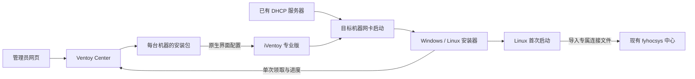

# 架构与状态

服务端部署目标与安装目标分开建模。服务端首先在 Rocky 9 与 fyhocsys 共机运行，也提供 Linux / Windows 二进制。任务安装目标由 `os`、ISO、hostname、MAC、目标磁盘与固件模式决定。

## 任务状态

`draft → ready → installing → installed`：普通装机，以及当前的 Windows 流程。

`draft → ready → installing → enrolling → enrolled`：Linux 配置 fyhocsys 接入。

`draft / ready → canceled`；客户端可在非终结执行阶段回报 `failed`。任何状态都不能直接重新领取 `installing`。取消无法撤销已开始的磁盘写入，因此开始后取消请求会被拒绝。

`enrolled` 的含义是节点包安装、连接文件导入及本地服务检查成功，不是中心确认心跳。当前尚未实现中心读接口适配和完整 sckocp 引导安装。

任务创建时保存机器和配置快照。一次授权生成一个独立凭据，24 小时有效。领取授权与状态转换在互斥锁下更新，先把新状态写到临时文件并同步、替换持久快照，再对外成功返回。支持一个进程，不支持共享数据目录的多实例部署。崩溃后重新读取状态，不自动重装或重跑任务。

## 接口

管理接口使用 `Authorization: Bearer 管理口令`，默认不启用跨域访问：

| 方法 / 路径 | 功能 |
| --- | --- |
| GET `/api/overview` | 已脱敏的机器、任务、媒体与服务地址 |
| POST `/api/machines` | 登记机器 |
| DELETE `/api/machines/{id}` | 移除没有未结束任务的登记；历史任务保留机器快照 |
| POST `/api/jobs` | 创建草稿 |
| POST `/api/jobs/{id}/arm` | 核对节点名、磁盘序列号和清盘选择后授权 |
| POST `/api/jobs/{id}/cancel` | 取消尚未开始的任务 |
| POST `/api/jobs/{id}/close` | 操作员确认客户端已停止安装后，将进行中记录结为失败 |
| GET `/api/jobs/{id}/bundle` | 下载已授权安装包 |

安装接口使用单任务凭据：

| 方法 / 路径 | 功能 |
| --- | --- |
| POST `/bootstrap/{id}/event` | 合法的单向状态转换；`installing` 只允许一次 |
| GET `/bootstrap/{id}/package` | 仅在 `enrolling` 阶段下载对应节点包 |
| GET `/bootstrap/{id}/connection` | 仅在 `enrolling` 阶段下载对应连接文件 |

状态文件包含秘密，0600 权限写入；Windows 使用受限 ACL。任务结束后清除管理端当前快照中的临时凭据、初始密码、密码哈希和连接文件副本（历史备份和已下载安装包需另行管理）。镜像和包读取限制在配置的文件根目录中。包哈希固定在任务快照，脚本在安装前验证。安装包本身包含限时凭据与初始系统设置，也应保密。

Linux 在替换状态文件后同步父目录，Windows 使用带 WRITE_THROUGH 的 MoveFileExW。控制器只有在持久化成功后才返回领取成功；存储写入失败时客户端必须停止安装。

MAC 和磁盘序列号是防误操作检查，不是抵御主动伪造客户端的强硬件认证。PXE 应放在受信的部署网段，控制脚本和 iVentoy 管理界面的访问。未知机器不进入清盘默认脚本。

## 后续必须完成

1. Rocky 9.8 同机部署和单台客户端真实 PXE 安装验收。
2. iVentoy 专业版适配：在确定版本上验证读取、变更、读回、回滚与单机规则撤销，才实现网页直接下发。
3. fyhocsys 中心侧身份关联、连接文件自动登记与新心跳确认；保持原授权边界。
4. Windows fyhocsys 节点实现、监控与压测工具的平台适配。
5. 安装中断后的自动超时诊断；批量选择、批量授权和安装并发限制。人工结单已实现，需操作员确认客户端停止安装。
6. Windows WinPE 构建自动化、WinRE 分区、驱动仓库；不同 Linux 版本的完整安装测试。
7. RPM / DEB 原生安装包、更多架构与更完整的审计/多用户能力。

这些是尚未实现的能力，不能用模拟回调或配置文件生成结果代替现场完成证明。
